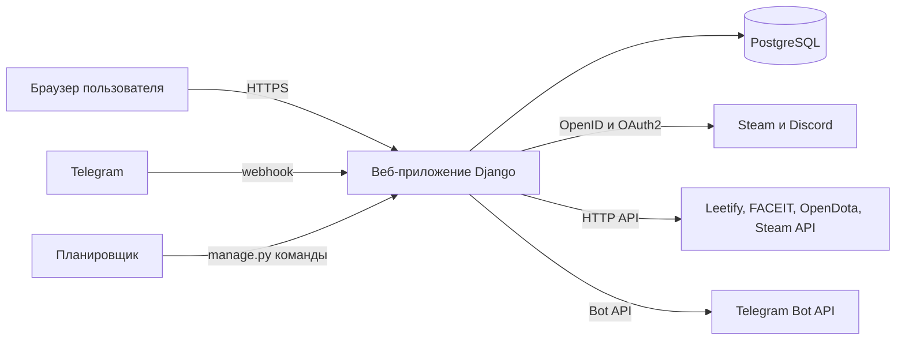
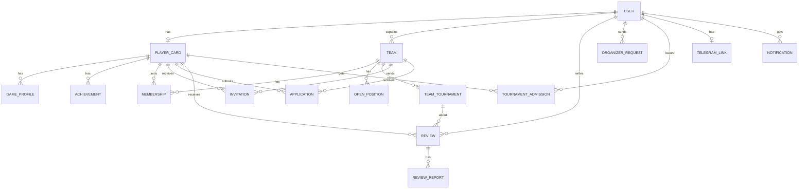
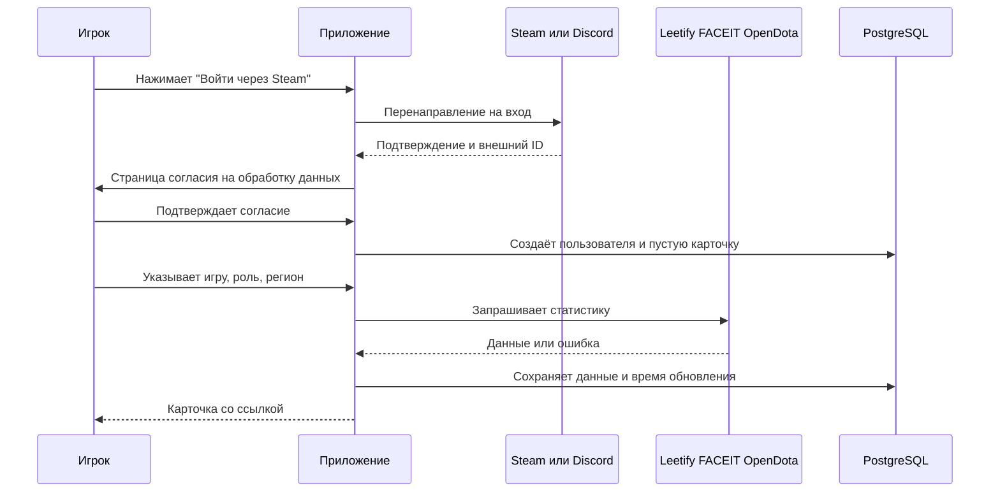
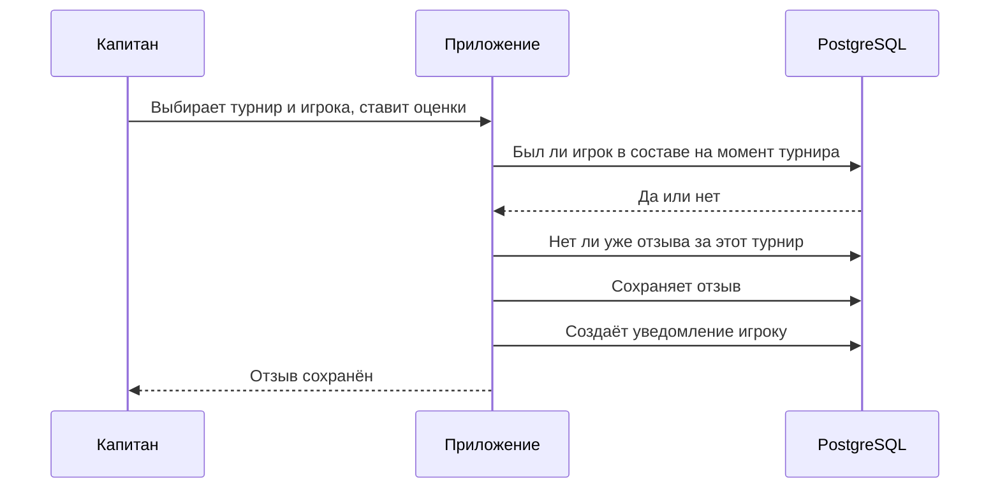

# Описание проекта (SDD): архитектура, проектирование и план разработки
## Проект: Esports Player Card

> Стандарты: IEEE 1016 (описание проекта через представления), ISO/IEC/IEEE 42010 (описание архитектуры)
> Основание: StRS проекта (playercard_v2.md), потребности SR-001…SR-027
> Версия: 1.0
> Автор: gumballomgg
> Дата: 03.11.2026
> Статус: черновик

---

## 1. Введение

### 1.1 Зачем этот документ

StRS отвечает на вопрос «чего хотят люди». Этот документ отвечает на вопрос «как мы это построим и что именно будем писать»: из каких частей состоит система, где что хранится, как части общаются друг с другом, в каком порядке разрабатывать и как проверять. Решения здесь принимаются осознанно, и для каждого нетривиального решения записано, **почему** выбрано именно оно.

### 1.2 Что считается готовым результатом

Работающее веб-приложение на Python и PostgreSQL, в котором выполняются все потребности SR-001…SR-027 и проходят критерии приёмки из приложения A документа StRS.

### 1.3 Как читать документ

Раздел 2 — кто и о чём спрашивает архитектуру. Разделы 3–9 — представления системы: контекст, состав, данные, интерфейсы, поведение, развёртывание, безопасность. Раздел 10 — решения с обоснованием. Раздел 11 — порядок разработки и тесты. Раздел 12 — открытые вопросы. В конце — матрица «потребность → модуль → тест» и словарь технических терминов.

---

## 2. Заинтересованные стороны и их интересы к архитектуре

В стандарте 42010 такие интересы называются concerns. Архитектура строится так, чтобы ответить на каждый.

| Сторона | Что ей важно от устройства системы | Где отвечает документ |
|---|---|---|
| Игрок | Быстро войти, не потерять данные, контролировать приватность | 5, 8, 9 |
| Капитан | Быстрый поиск, надёжные отзывы, уведомления | 4, 6, 7 |
| Организатор | Достоверность данных карточки | 6, 7 |
| Модератор | Удобная очередь проверки и след решений | 3, 8 |
| Создатели (разработчики) | Простота, возможность дописывать по частям, дешёвый хостинг, тесты | 3, 10, 11 |
| Внешние сервисы | Не превышать их лимиты и условия | 6, 10 |

---

## 3. Представление «Контекст и состав» (Composition)

### 3.1 Контекст

Система — одно веб-приложение. Снаружи к нему подключаются браузеры пользователей, Telegram и четыре источника данных.



Это **монолит**: один код, один процесс приложения, одна база. Внутри он разделён на модули (приложения Django), чтобы не превратиться в кашу (решение ADR-10).

### 3.2 Модули

| Модуль | За что отвечает | Потребности |
|---|---|---|
| `accounts` | Пользователь, роли, согласие на обработку данных, приватность, удаление аккаунта | SR-001, 018, 023, 026 |
| `players` | Карточка игрока, игровые профили CS2 и Dota 2, достижения | SR-002, 003, 007, 015, 017 |
| `integrations` | Клиенты Steam, Leetify, FACEIT, OpenDota и синхронизация данных | SR-002, 017, 027 |
| `teams` | Команды, состав, открытые позиции, история турниров | SR-008, 020, 021 |
| `recruiting` | Приглашения и заявки | SR-005, 010 |
| `reviews` | Отзывы капитанов и жалобы на них | SR-006, 011, 019 |
| `moderation` | Проверка достижений, заявки организаторов, допуск, журнал решений | SR-003, 013, 014, 022–025 |
| `notifications` | Уведомления в интерфейсе и Telegram-бот | SR-012, 016 |
| `search` | Поиск игроков и команд с фильтрами | SR-004, 009 |
| `web` | Главная страница, общие шаблоны, превью ссылок | SR-007 |

Правило зависимостей: модули `players`, `teams` и `accounts` — базовые, на них опираются остальные. Базовые модули не импортируют остальные, иначе получатся циклы.

### 3.3 Структура репозитория

```
playercard/
├── manage.py
├── pyproject.toml            # зависимости и настройки инструментов
├── docker-compose.yml        # приложение + PostgreSQL одной командой
├── Dockerfile
├── .env.example              # пример переменных окружения (секреты не коммитим)
├── config/                   # настройки Django, корневые URL
├── apps/
│   ├── accounts/
│   ├── players/
│   ├── integrations/
│   │   └── clients/          # steam.py, leetify.py, faceit.py, opendota.py
│   ├── teams/
│   ├── recruiting/
│   ├── reviews/
│   ├── moderation/
│   ├── notifications/
│   ├── search/
│   └── web/
├── templates/                # HTML-шаблоны
├── static/                   # стили, изображения
└── tests/                    # тесты (по одному набору на модуль)
```

---

## 4. Представление «Данные» (Information)

### 4.1 Модель данных



### 4.2 Таблицы и важные поля

**accounts**
- `User` — стандартный пользователь Django плюс `consent_at` (когда дал согласие, BR-09) и `is_organizer` (после подтверждения заявки, BR-03). Модератор — пользователь из группы «Модераторы» в админ-панели.

**players**
- `PlayerCard` — `user` (один к одному), `slug` (часть публичной ссылки), `nickname`, `avatar_url`, `region`, `languages` (массив), `discord_contact`, `telegram_contact`, `contacts_public` (по умолчанию false, BR-07).
- `GameProfile` — `card`, `game` (cs2 или dota2), `role`, внешние идентификаторы (`steam_id`, `faceit_id`, `dota_account_id`), `stats` (JSONB с подробностями из внешних сервисов), `primary_rating` (число для фильтров и сортировки), `rating_kind` (Premier, MMR…), `fetched_at`, `status` (ok, stale, private, error). Уникально по паре `card`+`game`.
- `Achievement` — `card`, `game`, `title`, `place`, `date`, `proof_url`, `screenshot`, `status` (pending, approved, rejected), `reject_reason`, `reviewed_by`, `reviewed_at`.

**teams**
- `Team` — `name`, `game`, `description`, `captain` (пользователь). Уникально по паре `captain`+`game` (BR-02).
- `OpenPosition` — `team`, `role`, `note`, `is_open`.
- `Membership` — `team`, `card`, `game`, `role`, `joined_at`, `left_at` (пусто, пока игрок в команде). Уникальный индекс по `card`+`game` только для строк, где `left_at` пусто (BR-01). Эта же таблица хранит историю команд игрока.
- `TeamTournament` — `team`, `name`, `date`, `result`.

**recruiting**
- `Invitation` — `team`, `card`, `message`, `status` (pending, accepted, declined, cancelled), `created_at`, `responded_at`. Одно ожидающее приглашение на пару команда+игрок.
- `Application` — `card`, `team`, `message`, `status`, `created_at`, `responded_at`.

**reviews**
- `Review` — `author` (капитан), `card`, `team_tournament`, три оценки `interaction`, `communication`, `mechanics`, `comment`, `status` (visible, hidden), `created_at`. Оценки проверяются на диапазон 1–5. Уникально по тройке `author`+`card`+`team_tournament` (BR-05).
- `ReviewReport` — `review`, `reporter`, `reason`, `status` (open, upheld, rejected), `resolved_by`, `resolution_note`.

**moderation**
- `OrganizerRequest` — `user`, `comment`, `status`.
- `TournamentAdmission` — `organizer`, `card`, `tournament_name`, `created_at`. Уникально по тройке.
- `ModerationLog` — `actor`, `action`, `target_type`, `target_id`, `note`, `created_at` (кто, когда, какое решение).

**notifications**
- `TelegramLink` — `user`, `chat_id`, `linked_at`. `TelegramLinkCode` — одноразовый код привязки со сроком жизни.
- `Notification` — `user`, `kind`, `payload`, `created_at`, `read_at`, `telegram_sent_at`.

**integrations**
- `SyncLog` — `game_profile`, `source`, `status`, `message`, `at` (чтобы видеть, почему данные не обновились).

### 4.3 Правила, которые охраняет сама база

Правило, зашитое в базу, нельзя обойти ошибкой в коде. Поэтому:

- BR-01 — уникальный индекс на активное участие «игрок + игра».
- BR-02 — уникальность «капитан + игра».
- BR-05 — уникальность «автор + игрок + турнир».
- Оценки 1–5 — ограничение на значения (CheckConstraint).

BR-04 (отзыв только от капитана, чей игрок был в составе на момент турнира) в индекс не уложить, это проверка в коде: ищем в `Membership` запись, которая пересекается по датам с турниром. Правило покрыто тестами.

### 4.4 Индексы для быстрого поиска (SR-004)

Индекс по `GameProfile(game, primary_rating)`, индекс по `GameProfile(game, role)`, индекс по региону, GIN-индекс по языкам. Выдача — страницами по 20 записей. Это нужно, чтобы поиск уложился в 1 секунду на росте базы.

### 4.5 Что и как удаляется (SR-018)

- Удаление аккаунта удаляет карточку, игровые профили, достижения, заявки, приглашения и полученные отзывы (каскадно).
- Отзывы, которые написал уходящий капитан, остаются, а автор показывается как «удалённый пользователь» (поле автора становится пустым). Так чужая репутация не пропадает вместе с чужим аккаунтом. Это проектное решение, его можно пересмотреть.

---

## 5. Представление «Интерфейсы» (Interface)

### 5.1 Страницы и адреса

| Адрес | Что это | Кто видит |
|---|---|---|
| `/` | Главная и поиск | все |
| `/players/` | Поиск игроков с фильтрами | все |
| `/p/<slug>/` | Публичная карточка игрока | все, без входа |
| `/teams/`, `/teams/<id>/` | Список и страница команды | все |
| `/me/` | Мой кабинет: карточка, настройки, приватность, Telegram | вошедший |
| `/me/achievements/` | Мои достижения | игрок |
| `/me/invitations/`, `/me/applications/` | Приглашения и заявки | вошедший |
| `/teams/<id>/manage/` | Управление составом, позициями, турнирами | капитан |
| `/reviews/new/` | Новый отзыв | капитан |
| `/org/` | Кабинет организатора, допуск игроков | организатор |
| `/tg/webhook/<секрет>/` | Приём событий от Telegram | только Telegram |
| `/admin/` | Панель модератора | модератор |

### 5.2 Превью ссылки (SR-007)

Шаблон карточки содержит в начале мета-теги Open Graph: заголовок (ник и игра), описание (основной рейтинг и отметка подтверждения), изображение (аватар) и адрес страницы. Discord и Telegram читают именно их. Страница отдаётся готовым HTML, поэтому превью работает без JavaScript.

### 5.3 Интерактивность без отдельного фронтенда

Фильтры поиска, пролистывание, приём и отклонение заявок работают через HTMX: нужный кусок страницы заменяется ответом сервера без перезагрузки всей страницы. Своего JavaScript почти нет.

### 5.4 Внешние сервисы

Каждый сервис отделён собственным клиентом в `integrations/clients/`. Все клиенты имеют одинаковый вид: на входе игровой профиль, на выходе единый набор нормализованных данных или одна из типовых ошибок.

| Клиент | Для чего | Что нужно |
|---|---|---|
| Steam (вход) | Вход через OpenID, получение ника и аватара | Ключ Steam Web API |
| Steam (данные) | Часы в играх | Публичность игровых данных у игрока |
| Discord (вход) | Вход через OAuth2, ник и аватар | Приложение в Discord Developer Portal |
| Leetify | Premier, Aim, K/D, HS%, число матчей CS2 | Доступ к API и ключ, условия проверить |
| FACEIT | ELO и уровень CS2 | Ключ FACEIT Data API |
| OpenDota | MMR, ранг, победы и поражения Dota 2 | Включённая у игрока публикация данных матчей |
| Telegram Bot API | Отправка уведомлений | Токен бота |

Единый набор ошибок клиентов: `NotFound`, `PrivateProfile`, `RateLimited`, `ServiceDown`. Код выше по стеку обрабатывает их одинаково, поэтому замена или отключение одного сервиса не ломает остальные. Точные адреса запросов и поля ответов беру из документации каждого сервиса при реализации клиента, здесь они не фиксируются.

---

## 6. Представление «Поведение» (Interaction)

### 6.1 Вход и создание карточки (SR-001, 002, 015, 026)



Если внешний сервис вернул ошибку, карточка всё равно создаётся. Игрок видит понятное пояснение (например, «включите публикацию данных матчей в Dota 2»), а статус профиля становится `private` или `error`.

### 6.2 Отзыв капитана (SR-011, BR-04…BR-06)



Если игрока не было в составе или отзыв уже есть, приложение отказывает с объяснением. Вторая защита стоит в самой базе (уникальный индекс).

### 6.3 Приглашение и заявка (SR-005, 010, 020, BR-01, BR-07)

1. Капитан или игрок создаёт приглашение или заявку.
2. Приложение проверяет BR-01: нет ли у игрока активной команды по этой игре.
3. Создаётся уведомление в интерфейсе и, если Telegram привязан, сообщение в Telegram.
4. Вторая сторона принимает или отклоняет.
5. При принятии в одной операции с базой создаётся `Membership` и закрываются остальные ожидающие приглашения и заявки этого игрока по этой игре.
6. После принятия контакты игрока открываются капитану (BR-07).

### 6.4 Обновление данных по расписанию (SR-002, 017, 027)

Команда `manage.py sync_profiles` запускается планировщиком, например каждый час.

1. Берёт ограниченное число профилей, которые обновлялись давнее всех.
2. Для каждого вызывает нужные клиенты по очереди, с таймаутом и ограничением частоты.
3. При успехе обновляет `stats`, `primary_rating`, `fetched_at`, ставит статус `ok`.
4. При ошибке старые данные остаются, статус становится `stale` или `error`, запись попадает в `SyncLog`.
5. При `RateLimited` команда останавливается и продолжит в следующий запуск.

Карточка всегда показывает последние сохранённые данные и дату обновления. Если внешний сервис лежит, сайт продолжает работать (SR-027, режим «внешний сервис недоступен»).

### 6.5 Telegram (SR-012, 016)

- **Привязка.** В кабинете игрок нажимает «Подключить Telegram», приложение создаёт одноразовый код и ссылку на бота. Игрок нажимает «Старт», Telegram присылает на webhook сообщение с кодом, приложение связывает аккаунт и чат.
- **Webhook.** Telegram сам присылает события на адрес `/tg/webhook/<секрет>/`. Дополнительно проверяется секретный заголовок, который задаётся при регистрации webhook.
- **Отправка.** Функция `notify(user, kind, payload)` сначала записывает `Notification` в базу, затем пытается отправить сообщение. Если Telegram недоступен, уведомление остаётся доступным в интерфейсе, а команда `send_pending_notifications` повторит отправку.
- **Реализация.** Обычные HTTP-запросы к Bot API из Python, без отдельного бот-фреймворка (ADR-06).

---

## 7. Представление «Зависимости» (Dependency)

### 7.1 Зависимости между модулями

```
web ─────────┬─> search ──> players, teams
             ├─> players ─> accounts, integrations
             └─> teams ───> players, accounts
recruiting ─────> teams, players, notifications
reviews ────────> teams, players, notifications
moderation ─────> players, reviews, accounts, notifications
notifications ──> accounts
integrations ───> (внешние сервисы), players
```

Базовые модули (`accounts`, `players`, `teams`) не знают о верхних. Верхние зависят от них.

### 7.2 Внешние зависимости

| Что | Зачем | Что будет, если пропадёт |
|---|---|---|
| Steam, Discord | Вход | Новые пользователи не смогут войти, старые сессии работают |
| Leetify, FACEIT, OpenDota, Steam API | Данные карточки | Карточки показывают последние данные с датой |
| Telegram | Уведомления | Уведомления только в интерфейсе |
| PostgreSQL | Всё | Сайт не работает |

### 7.3 Библиотеки

| Библиотека | Для чего |
|---|---|
| Django | Основа приложения, пользователи, ORM, миграции, админ-панель |
| django-allauth | Вход через Steam и Discord |
| psycopg | Подключение к PostgreSQL |
| httpx | Запросы к внешним API |
| HTMX | Обновление частей страницы |
| Pillow | Обработка скриншотов |
| gunicorn, WhiteNoise | Запуск приложения и отдача статических файлов |
| pytest, pytest-django, respx | Тесты и заглушки внешних сервисов |
| ruff | Проверка стиля кода |

Точные версии фиксируются в `pyproject.toml` при создании проекта: берём актуальные стабильные на тот момент.

---

## 8. Представление «Безопасность и приватность»

- **Вход.** Паролей у нас нет, вход только через Steam и Discord. Сессии и защита от подделки форм (CSRF) — встроенные в Django.
- **Права.** Роль проверяется в одном месте, в `permissions.py`, и применяется ко всем страницам и действиям. Проверки по объектам: приглашать может только капитан своей команды, отзыв пишет только капитан по своему турниру, отметку допуска ставит только организатор.
- **Модератор.** Работает через встроенную админ-панель с отдельной группой прав. Каждое решение (подтвердить, отклонить, скрыть отзыв) пишется в `ModerationLog`.
- **Секреты.** Ключи API, токен бота, секрет webhook и ключ базы хранятся только в переменных окружения. В репозитории лежит `.env.example` без значений.
- **Персональные данные.** Согласие при первом входе (SR-026), контакты скрыты по умолчанию (BR-07), удаление карточки и данных по кнопке (SR-018).
- **Скриншоты.** Проверка типа и размера, пережатие через Pillow до ≤ 2 МБ, удаление служебных данных из файла.
- **Публичные страницы.** Показывают только то, что игрок разрешил показывать.
- **Журналы.** Ошибки внешних сервисов и работы синхронизации хранятся в `SyncLog`, ключи и токены в журналы не попадают.

---

## 9. Представление «Развёртывание» (Deployment)

### 9.1 Локально (для разработки)

`docker compose up` поднимает два контейнера: приложение и PostgreSQL. Миграции базы применяются командой `manage.py migrate`. Для тестов используется отдельная тестовая база, которая создаётся автоматически.

### 9.2 В интернете

Приложение запускается через gunicorn, статика отдаётся через WhiteNoise, база — PostgreSQL на хостинге. Все настройки приходят из переменных окружения, поэтому тот же образ работает на любом хостинге. Для планировщика нужен периодический запуск команд `sync_profiles` и `send_pending_notifications`, это возможностями хостинга (cron-задача) или отдельным контейнером.

Требования к хостингу, от которых зависит выбор: HTTPS с настоящим доменом (нужен для webhook Telegram и для превью ссылок), PostgreSQL, периодические задачи, хранилище для скриншотов. Выбор хостинга — открытый вопрос (раздел 12).

---

## 10. Проектные решения и их обоснование (ADR)

Здесь записано, что выбрано, почему и какой ценой. Статус «принято» значит, что решение можно менять, но только осознанно.

**ADR-01. Язык Python и фреймворк Django.** *Принято.*
Почему: нужны пользователи с ролями, много связанных таблиц и панель для модератора. Всё это в Django уже есть, а в Flask или FastAPI пришлось бы писать самому.
Альтернативы: Flask (минимальный, всё собирать вручную), FastAPI (для сервиса данных без страниц).
Цена: Django большой и строгий, на старте требует времени на изучение.

**ADR-02. База данных PostgreSQL.** *Принято.*
Почему: надёжная, бесплатная, умеет уникальные индексы с условием (нужны для BR-01), JSONB для статистики, массивы и GIN-индексы для языков.
Альтернативы: SQLite (проще, но слабее для нескольких одновременных пользователей и не умеет всего перечисленного), MySQL.
Цена: нужна отдельная база на хостинге.

**ADR-03. Страницы собираются на сервере, динамика через HTMX, без React.** *Принято.*
Почему: превью в Discord и Telegram читают готовый HTML и не выполняют JavaScript. Страница, которая собирается в браузере, даст пустое превью.
Альтернативы: отдельный фронтенд на React с собственным API.
Цена: сложные интерфейсы делать неудобнее, но для нашего набора страниц этого достаточно.

**ADR-04. Вход через django-allauth.** *Принято.*
Почему: готовая и проверенная поддержка Steam (OpenID) и Discord (OAuth2), писать вручную опасно.
Альтернативы: писать самим, или использовать пароли.
Цена: зависимость от пакета и его настроек.

**ADR-05. Обновление данных командой по расписанию, без очереди задач.** *Принято.*
Почему: Celery и Redis усложняют проект и неудобны на бесплатном хостинге. Команды Django, запускаемые планировщиком, проще и достаточны для нашего объёма.
Альтернативы: Celery с брокером, фоновые потоки внутри приложения.
Цена: обновление идёт пачками, а не мгновенно. Если объём вырастет, перейдём на очередь, интерфейс клиентов от этого не изменится.

**ADR-06. Telegram через webhook и обычные HTTP-запросы.** *Принято.*
Почему: webhook не требует постоянного опроса, а прямые запросы к Bot API не тянут отдельный бот-фреймворк и работают с обычным синхронным Django.
Альтернативы: polling, библиотеки aiogram или python-telegram-bot.
Цена: часть мелочей (повторы, разбор сообщений) пишем сами.

**ADR-07. Правила предметной области защищены в базе, а не только в коде.** *Принято.*
Почему: код можно сломать случайно, а уникальный индекс не даст создать дубль даже при ошибке.
Альтернативы: проверять только в коде.
Цена: нужно аккуратно оформлять миграции и понятно обрабатывать ошибки базы в интерфейсе.

**ADR-08. Статистика хранится как JSONB плюс одно число для фильтров.** *Принято.*
Почему: у сервисов разные наборы полей, и они меняются. JSONB вмещает всё, а `primary_rating` даёт быстрый поиск и сортировку.
Альтернативы: отдельный столбец под каждый показатель.
Цена: показатели внутри JSONB нельзя проверить ограничениями базы.

**ADR-09. Скриншоты хранятся через слой хранилища Django.** *Открыто.*
Почему: на многих бесплатных хостингах диск стирается при перезапуске. Слой хранилища позволяет локально писать на диск, а на сервере подключить S3-совместимое хранилище, не меняя код.
Альтернативы: хранить картинки в самой базе.
Цена: нужен внешний сервис хранения, выбор зависит от хостинга.

**ADR-10. Монолит из модулей, а не микросервисы.** *Принято.*
Почему: проект маленький, команда небольшая, один деплой проще. Микросервисы добавили бы сетевых ошибок и сложностей без выгоды.
Альтернативы: несколько сервисов.
Цена: все модули запускаются вместе, и расти придётся по одной базе.

**ADR-11. Совпадение отзывов с составом проверяется по истории участия.** *Принято.*
Почему: так получается честно проверить BR-04, не заводя отдельного «подтверждения турнира».
Альтернативы: подтверждение турнира организатором (выходит за границы проекта, BR-11).
Цена: капитану нужно вести историю состава и турниров в системе.

---

## 11. Порядок разработки и проверки

### 11.1 Этапы

| Этап | Что делаем | Потребности | Готово, когда |
|---|---|---|---|
| 0 | Каркас: репозиторий, Docker Compose, PostgreSQL, ruff, тесты, CI | — | Пустое приложение запускается, тест проходит |
| 1 | Модель пользователя, вход через Steam и Discord, согласие, пустая карточка | SR-001, 026 | Игрок входит и видит карточку за ≤ 30 секунд |
| 2 | Клиенты внешних сервисов, синхронизация, статусы данных | SR-002, 017, 027 | Данные карточки совпадают с источниками, сбой сервиса не ломает страницу |
| 3 | Публичная карточка, регион, роль, игра, превью ссылки | SR-007, 015 | Ссылка в Discord и Telegram показывает превью |
| 4 | Команды, состав, приглашения и заявки | SR-008, 010, 005, 020 | BR-01 и BR-02 соблюдаются, в том числе на уровне базы |
| 5 | Поиск игроков и команд | SR-004, 009 | Ответ ≤ 1 секунды на тестовом наборе данных |
| 6 | Турниры команды, отзывы, жалобы | SR-021, 006, 011, 019 | BR-04…BR-06 работают, повторный отзыв запрещён |
| 7 | Модерация: достижения, организатор, допуск, журнал | SR-003, 013, 014, 022–025 | Модератор работает из админ-панели, решения попадают в журнал |
| 8 | Telegram: привязка, webhook, уведомления | SR-012, 016 | Уведомление приходит ≤ 1 минуты |
| 9 | Приватность, удаление данных, деплой, журналы | SR-018 | Удалённая карточка недоступна, приложение работает в интернете |

Этапы идут по порядку: следующий не начинается, пока у предыдущего не выполнено условие «готово». Сроки не заданы, пока не известно, сколько времени вы можете тратить.

### 11.2 Как проверяем

Каждый критерий приёмки из приложения A StRS превращается в автоматический тест. Название теста содержит номер потребности, например `test_sr_011_review_rejected_if_not_in_roster`. Благодаря этому при каждом изменении видно, какие потребности ещё работают.

- **Модульные тесты.** Правила (BR-01…BR-11), проверки прав, расчёт средних оценок.
- **Интеграционные тесты.** Страницы и действия через тестовый клиент Django с настоящей тестовой PostgreSQL.
- **Заглушки внешних сервисов.** Через respx подменяем ответы Steam, Leetify, FACEIT, OpenDota и Telegram, тесты не обращаются к реальным сервисам.
- **Тесты ошибок.** Недоступный сервис, закрытый профиль, превышение лимита, пустые ответы.
- **Тест превью.** Страница карточки содержит нужные мета-теги.
- **Автоматическая проверка (CI).** При каждом изменении запускаются ruff и все тесты.

### 11.3 Правила работы

- Одна задача, одна ветка, одно небольшое изменение; в основную ветку попадает только то, что прошло тесты.
- Секреты не коммитим, а `.env.example` обновляем вместе с кодом.
- Каждое новое решение, которое меняет архитектуру, записываем как ADR.
- Названия таблиц, модулей и переменных — на английском, тексты интерфейса — на русском.

---

## 12. Открытые вопросы и риски

| № | Вопрос | Почему важен | Как закрываем |
|---|---|---|---|
| Q-1 | Даёт ли Leetify публичный API для такого проекта, какие лимиты и условия | Без него нет Premier, Aim, K/D, HS% (SR-002) | Прочитать документацию и условия до этапа 2, иначе согласовать замену источника |
| Q-2 | Как именно получать ELO и уровень FACEIT и какой нужен ключ | Данные FACEIT (SR-002) | Прочитать документацию FACEIT Data API |
| Q-3 | Видимость игровых данных в Steam и OpenDota у игроков | Без открытых данных карточка пустая | Понятные тексты ошибок, подсказка игроку, статус `private` |
| Q-4 | Где хостим и какая у хостинга база и планировщик | От этого зависят лимиты, фоновые задачи, домен и HTTPS | Выбрать хостинг до этапа 8 |
| Q-5 | Где хранить скриншоты | ADR-09 | Решить вместе с хостингом |
| Q-6 | Срок, в течение которого капитан может оставить отзыв | BR-06 | Согласовать до этапа 6 |
| Q-7 | Что показывать как отзыв удалённого капитана | Пункт 4.5 | Подтвердить проектное решение |
| Q-8 | Точные версии Python, Django и библиотек | Совместимость | Зафиксировать при создании каркаса |

---

## Приложение A. Матрица «потребность → модуль → проверка»

| Потребность | Модуль | Проверка (тест) |
|---|---|---|
| SR-001 | accounts | `test_sr_001_login_creates_card` |
| SR-002 | players, integrations | `test_sr_002_cs2_data_matches_sources` |
| SR-003 | players, moderation | `test_sr_003_achievement_upload_pending` |
| SR-004 | search | `test_sr_004_filters_and_speed` |
| SR-005 | recruiting | `test_sr_005_application_created` |
| SR-006 | reviews, players | `test_sr_006_review_shown_on_card` |
| SR-007 | web, players | `test_sr_007_og_tags_present` |
| SR-008 | teams | `test_sr_008_team_created_captain_rights` |
| SR-009 | search | `test_sr_009_captain_sees_verified_data` |
| SR-010 | recruiting | `test_sr_010_invitation_blocked_if_in_team` |
| SR-011 | reviews | `test_sr_011_review_rejected_if_not_in_roster` |
| SR-012 | notifications | `test_sr_012_telegram_notification_on_application` |
| SR-013 | players, moderation | `test_sr_013_organizer_sees_rating_and_reviews` |
| SR-014 | players | `test_sr_014_approved_achievements_visible` |
| SR-015 | players | `test_sr_015_manual_fields_saved` |
| SR-016 | notifications | `test_sr_016_telegram_link_flow` |
| SR-017 | players, integrations | `test_sr_017_dota_data_matches_opendota` |
| SR-018 | accounts | `test_sr_018_privacy_and_delete` |
| SR-019 | reviews | `test_sr_019_report_reaches_moderator` |
| SR-020 | teams, recruiting | `test_sr_020_roster_management` |
| SR-021 | teams | `test_sr_021_tournament_history_shown` |
| SR-022 | moderation | `test_sr_022_admission_mark_organizer_only` |
| SR-023 | accounts, moderation | `test_sr_023_organizer_request_approved` |
| SR-024 | moderation | `test_sr_024_approve_or_reject_achievement` |
| SR-025 | moderation, reviews | `test_sr_025_hide_review_recalculates` |
| SR-026 | accounts | `test_sr_026_no_card_without_consent` |
| SR-027 | integrations | `test_sr_027_stale_data_shown_with_date` |

## Приложение B. Технические термины

- **Монолит** — одно приложение, внутри разделённое на части, но запускаемое как целое.
- **Миграция** — файл, описывающий изменение структуры базы, чтобы её можно было воспроизвести где угодно.
- **ORM** — слой, через который с таблицами работают как с Python-объектами.
- **JSONB** — столбец PostgreSQL для данных свободной формы.
- **Уникальный индекс** — индекс, который одновременно запрещает дубли.
- **Webhook** — адрес на нашем сервере, на который сторонний сервис сам присылает события.
- **Open Graph** — мета-теги страницы, из которых мессенджеры строят превью ссылки.
- **HTMX** — маленькая библиотека, заменяющая части страницы ответами сервера.
- **CI** — автоматический запуск проверок при каждом изменении кода.
- **Заглушка (мок)** — подмена внешнего сервиса в тестах.
- **ADR** — запись архитектурного решения с причинами и ценой.

## Приложение C. Что дальше

После этого документа можно написать SyRS: системные требования выводятся из StRS и из принятых здесь решений (производительность, интерфейсы, режимы, безопасность).
