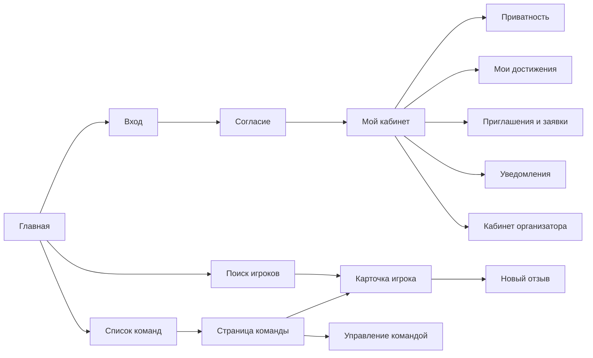

# Спецификация системных требований (SyRS)
## Проект: Esports Player Card. Веб-интерфейс и страницы

> Стандарт: ISO/IEC/IEEE 29148:2018 (SyRS)
> Основание: StRS v2.0 (потребности SR-001…SR-027), SDD v1.0 (архитектура)
> Версия: 1.0
> Автор: gumballomgg
> Дата: 03.11.2026
> Статус: черновик

---

## 1. Введение

### 1.1 Зачем нужен этот документ

StRS говорит, **чего хотят люди**. Этот документ говорит, **что должна делать система**, чтобы эти желания исполнились. Здесь самое подробное описание того, что видит и нажимает пользователь: все страницы, кнопки, аватарки, цвета, язык и форматы. Плюс на чём и как всё это пишется, чтобы потом можно было спокойно менять и улучшать проект.

### 1.2 Границы

**Входит:** все страницы веб-приложения, общие правила оформления, технологии интерфейса, форматы данных, требования к скорости, безопасности и развитию проекта.

**Не входит:** внутреннее устройство кода (таблицы, модули, сервисы). Оно описано в SDD. Здесь про него только то, что нужно для понимания страниц.

### 1.3 Как читать

- Раздел 2: общая картина и список страниц.
- Раздел 3: правила, общие для всех страниц.
- Раздел 4: каждая страница отдельно. Это главный раздел.
- Разделы 5–9: скорость, интерфейсы, режимы, безопасность, данные.
- Раздел 10: нормативы.
- Раздел 11: как менять проект дальше.
- Разделы 12–13: проверка, допущения. Приложения: связи с StRS и вопросы.

### 1.4 Нумерация требований

- `SYS-G..` — общие правила всех страниц.
- `SYS-P..` — требования к конкретной странице (номер совпадает с номером страницы).
- `SYS-N..` — нефункциональные (скорость, безопасность, данные и так далее).
- У каждого требования указано основание, то есть потребность SR из StRS.
- Номера не переиспользуются: если требование убрали, оно помечается «снято», а новому даётся новый номер.

### 1.5 Несколько слов

- **Страница** — один адрес в браузере. У неё есть шаблон (HTML-файл) и функция на Python, которая собирает данные.
- **Шаблон** — HTML-файл с вставками, куда сервер подставляет данные (ник, рейтинг и так далее).
- **Кнопка** — элемент, на который нажимают и который что-то делает (отправляет форму, меняет данные). **Ссылка** — элемент, который переводит на другую страницу. Внешне они могут отличаться.
- **Значок (бейдж)** — небольшая метка, например «Подтверждено». Она не кликабельна.

---

## 2. Общая картина

### 2.1 Что это за система

Веб-сайт на русском языке. Пользователь входит через Steam или Discord, получает публичную карточку, ищет команду или игрока, подаёт заявки, получает отзывы. Модератор работает в панели администратора. Страницы собираются на сервере (Python, Django) и приходят в браузер готовым HTML.

### 2.2 Карта переходов



### 2.3 Список всех страниц

| № | Страница | Адрес | Кто видит |
|---|---|---|---|
| PG-01 | Главная | `/` | все |
| PG-02 | Вход | `/login/` | гость |
| PG-03 | Согласие на обработку данных | `/consent/` | вошедший без согласия |
| PG-04 | Поиск игроков | `/players/` | все |
| PG-05 | Карточка игрока | `/p/<slug>/` | все |
| PG-06 | Список команд | `/teams/` | все |
| PG-07 | Страница команды | `/teams/<id>/` | все |
| PG-08 | Создание и управление командой | `/teams/new/`, `/teams/<id>/manage/` | вошедший, капитан |
| PG-09 | Мой кабинет (редактирование карточки) | `/me/` | вошедший |
| PG-10 | Приватность и аккаунт | `/me/privacy/` | вошедший |
| PG-11 | Мои достижения | `/me/achievements/` | игрок |
| PG-12 | Приглашения и заявки | `/me/invitations/`, `/me/applications/` | вошедший |
| PG-13 | Новый отзыв | `/reviews/new/` | капитан |
| PG-14 | Уведомления | `/me/notifications/` | вошедший |
| PG-15 | Кабинет организатора и заявка на роль | `/org/`, `/org/request/` | вошедший, организатор |
| PG-16 | Панель модератора | `/admin/` | модератор |
| PG-17 | Страницы ошибок (403, 404, 500) | — | все |
| PG-18 | О проекте и политика данных | `/about/`, `/privacy/` | все |

Технические адреса, которые не являются страницами: `/logout/` (выход), `/tg/webhook/<секрет>/` (события Telegram).

---

## 3. Общие правила для всех страниц

### 3.1 На чём и как пишутся страницы (технологии)

**SYS-G01.** Система должна собирать страницы на сервере: браузер получает готовый HTML. *(SR-007, превью ссылок)*

Из чего состоит одна страница:

| Часть | Язык и формат | Где лежит |
|---|---|---|
| Структура и текст | HTML5 в шаблонах Django | `templates/` |
| Внешний вид | Обычный CSS (один файл, CSS-переменные) | `static/css/site.css` |
| Мелкая динамика (фильтры, приём заявок без перезагрузки) | HTMX (подключается как обычный файл) | `static/js/htmx.min.js` |
| Копирование ссылки, раскрытие меню | Очень маленький JavaScript, около 20–30 строк | `static/js/site.js` |
| Данные для страницы | Python-функция, собирающая данные | `apps/<модуль>/views.py` |
| Поля форм и их проверка | Формы Django на Python | `apps/<модуль>/forms.py` |
| Адреса страниц | Список адресов на Python | `apps/<модуль>/urls.py` |
| Картинки интерфейса (значки) | SVG | `static/img/` |

**SYS-G02.** Система не должна использовать отдельный фронтенд-фреймворк (React, Vue). Причина: превью ссылок в Discord и Telegram читают готовый HTML.

**SYS-G03.** Все страницы должны наследовать один базовый шаблон `templates/base.html`, где описаны шапка, подвал, подключение стилей и мета-теги. В шаблонах конкретных страниц описывается только их содержимое.

**SYS-G04.** Повторяющиеся куски (строка игрока в списке, блок отзыва, значок) должны лежать в отдельных маленьких шаблонах в `templates/partials/` и подключаться везде, где нужны. Тогда изменение в одном месте меняет всё на сайте.

**SYS-G05.** Страница должна работать и без JavaScript. Фильтры поиска — обычная форма, которая отправляется нажатием кнопки. HTMX только делает то же самое плавнее, без перезагрузки.

Структура шаблонов:

```
templates/
├── base.html
├── partials/        # маленькие повторяющиеся кусочки
│   ├── header.html
│   ├── footer.html
│   ├── avatar.html
│   ├── badge.html
│   ├── player_row.html
│   ├── review_item.html
│   └── messages.html
├── web/             # главная, о проекте, политика, ошибки
├── accounts/        # вход, согласие, кабинет, приватность
├── players/         # карточка, достижения
├── teams/           # список, страница, управление
├── recruiting/      # приглашения и заявки
├── reviews/         # новый отзыв
├── notifications/   # уведомления
└── moderation/      # кабинет организатора, заявка на роль
```

### 3.2 Язык и форматы

**SYS-G06.** Весь текст интерфейса должен быть на русском языке. Страница должна иметь `<html lang="ru">`, кодировка UTF-8.

**SYS-G07.** Тексты интерфейса должны лежать прямо в шаблонах, чтобы их было легко найти и поменять. Если потом понадобится английский, подключим механизм перевода Django, это описано в разделе 11.

**SYS-G08.** Код (названия файлов, функций, переменных, таблиц) должен быть на английском.

Форматы показа:

| Что | Формат | Пример |
|---|---|---|
| Дата | ДД.ММ.ГГГГ | 03.11.2026 |
| Время | в первой версии не показывается; в базе хранится в UTC | — |
| Целые рейтинги | с пробелом-разделителем тысяч | 18 250 |
| Дробные показатели | с запятой | K/D 1,24; винрейт 54,3 % |
| Средняя оценка отзывов | число с одной цифрой после запятой, из 5 | 4,3 из 5 |
| Отсутствие данных | длинное тире | — |

Часовой пояс для показа задаётся одной настройкой проекта и в первой версии не используется, пока время не выводится на экран.

### 3.3 Внешний вид (общий)

**SYS-G09.** Внешний вид должен быть простым: светлая тема, много воздуха, один акцентный цвет. Тёмная тема в первой версии не делается (раздел 11).

**SYS-G10.** Цвета, размеры и отступы должны задаваться переменными в начале `site.css`, а не повторяться по файлу. Тогда смена цвета делается правкой одной строки.

Основные значения (предложение, можно менять):

| Что | Значение |
|---|---|
| Фон страницы | `#F7F8FA` |
| Фон блока (карточки) | `#FFFFFF` |
| Основной текст | `#1B1F24` |
| Приглушённый текст | `#5B6470` |
| Акцент (основные кнопки, ссылки) | `#2F5BEA`, при наведении `#2447C0` |
| Успех (подтверждено) | `#1E8E4A` |
| Предупреждение (данные устарели) | `#B7791F` |
| Ошибка и опасные действия | `#C62828` |
| Линии и рамки | `#DDE1E7` |

Контраст текста с фоном не менее 4,5 : 1. Цвет никогда не должен быть единственным признаком: у значка статуса есть и текст.

| Что | Значение |
|---|---|
| Шрифт | системный: `system-ui, -apple-system, "Segoe UI", Roboto, sans-serif` (ничего скачивать не нужно) |
| Размер основного текста | 16 px, межстрочный интервал 1,5 |
| Заголовок страницы (h1) | 28 px, жирный |
| Заголовок блока (h2) | 22 px, жирный |
| Подзаголовок (h3) | 18 px, полужирный |
| Мелкий текст | 14 px |
| Отступы | шаг 4, 8, 16, 24, 32 px |
| Скругление блоков и кнопок | 8 px |
| Ширина содержимого | не больше 960 px по центру |

### 3.4 Адаптивность (телефон, планшет, компьютер)

**SYS-G11.** Страницы должны корректно отображаться на экранах шириной от 360 px и выше. Страница пишется сначала под телефон, затем расширяется.

| Ширина | Поведение |
|---|---|
| до 640 px (телефон) | Одна колонка. Кнопки на всю ширину. Таблицы превращаются в список блоков. Меню в шапке сворачивается |
| 641–1024 px (планшет) | Одна колонка с большими отступами, фильтры над списком |
| от 1025 px (компьютер) | Фильтры слева (колонка 280 px), результаты справа |

**SYS-G12.** Любая кнопка и ссылка должна иметь область нажатия не меньше 44 × 44 px.

### 3.5 Общие элементы: шапка, подвал, сообщения

**Шапка** (на каждой странице):

```
┌────────────────────────────────────────────────────────────────┐
│ EPC     Игроки   Команды                  (ава) Ник ▾          │
└────────────────────────────────────────────────────────────────┘
```

| Элемент | Что это | Кому виден | Что происходит при нажатии |
|---|---|---|---|
| «EPC» (текстовый логотип) | ссылка | всем | переход на `/` |
| «Игроки» | ссылка | всем | `/players/` |
| «Команды» | ссылка | всем | `/teams/` |
| «Войти» | основная кнопка | гостю | `/login/` |
| Аватарка 32 px и ник с треугольником | меню | вошедшему | раскрывается список (см. ниже) |

Меню вошедшего (раскрывается элементом `<details>`, работает без JavaScript):

| Пункт | Кому виден | Куда ведёт |
|---|---|---|
| Моя карточка | вошедшему | `/p/<мой slug>/` |
| Мой кабинет | вошедшему | `/me/` |
| Приглашения и заявки (со счётчиком) | вошедшему | `/me/invitations/` |
| Уведомления (со счётчиком непрочитанных) | вошедшему | `/me/notifications/` |
| Кабинет организатора | организатору | `/org/` |
| Панель модератора | модератору | `/admin/` |
| Выйти | вошедшему | кнопка, отправляет запрос выхода, затем `/` |

**Подвал:** слева текст «Esports Player Card», справа ссылки «О проекте» (`/about/`) и «Политика данных» (`/privacy/`). Подвал на странице один и тот же всегда.

**Сообщения над содержимым** (после действий): зелёная полоса «Сохранено», красная «Не получилось: …», жёлтая с предупреждением. Полоса исчезает при следующем переходе, закрывать её вручную не нужно.

### 3.6 Кнопки и ссылки (общие правила)

**SYS-G13.** Кнопки должны быть четырёх видов:

| Вид | Как выглядит | Когда использовать |
|---|---|---|
| Основная | Заливка акцентным цветом, белый текст | Главное действие на экране (не больше одной на блок) |
| Вторичная | Белая, рамка акцентного цвета | Остальные действия |
| Опасная | Красная заливка | Удалить, исключить, отклонить. Всегда с подтверждением |
| Текстовая ссылка | Акцентный цвет, подчёркивание при наведении | Переходы по страницам |

**SYS-G14.** У каждой кнопки должны быть состояния: обычное, наведение (цвет темнее), нажатие, неактивна (серая, курсор запрета) и фокус (видимая рамка при переходе клавишей Tab).

**SYS-G15.** Любое необратимое действие (исключить игрока, отклонить достижение, удалить карточку) должно сначала спрашивать подтверждение. Для этого используется атрибут HTMX `hx-confirm` или отдельная страница подтверждения.

**SYS-G16.** Кнопка, которая отправляет форму, должна после нажатия блокироваться до ответа сервера, чтобы действие не выполнилось дважды.

Что кликабельно, а что нет:

| Элемент | Кликабелен? |
|---|---|
| Ник игрока в списке и аватарка рядом | Да, ведёт на карточку |
| Аватарка и ник на самой карточке | Нет |
| Название команды | Да, ведёт на страницу команды |
| Значки («Подтверждено», «Проверено организатором») | Нет |
| Блок с рейтингом и средними оценками | Нет |
| Контакт в Telegram (если открыт) | Да, ссылка `t.me/<ник>` |
| Контакт в Discord (если открыт) | Нет, это текст; рядом кнопка «Копировать» |
| Заголовки блоков | Нет |

### 3.7 Аватарки

**SYS-G17.** Аватарка игрока должна браться из сервиса, через который он вошёл первым (Steam или Discord). Игрок не загружает свою. Платформа хранит только ссылку на картинку и обновляет её при синхронизации данных.

**SYS-G18.** Аватарка должна показываться кругом. Размеры:

| Где | Размер |
|---|---|
| Шапка (меню) | 32 px |
| Строки списков (поиск, состав, уведомления) | 40 px |
| Блок «История команд» и отзывы | 32 px |
| Шапка карточки игрока | 96 px |

**SYS-G19.** У аватарки обязательно задаются ширина и высота (чтобы страница не прыгала при загрузке), атрибут `alt` с ником и `loading="lazy"`, кроме аватарки в шапке карточки.

**SYS-G20.** Если у игрока нет аватарки или картинка не загрузилась, должна показываться заглушка: круг того же размера с первой буквой ника. Цвет круга выбирается по нику из заранее заданных 8 цветов, поэтому у одного игрока он всегда один и тот же.

**SYS-G21.** У команды логотипа нет. Вместо него показывается квадрат со скруглением и первыми буквами названия (до двух), цвет выбирается так же, как у заглушки игрока.

### 3.8 Значки (бейджи)

| Значок | Цвет | Когда показывается |
|---|---|---|
| Подтверждено | зелёный, с галочкой | Данные получены из внешнего сервиса (BR-10) или достижение подтверждено модератором |
| Проверено организатором: <турнир> | синий | Организатор допустил игрока к турниру |
| Данные устарели, обновлено ДД.ММ.ГГГГ | жёлтый | Внешний сервис недоступен или данные давно не обновлялись (SR-027) |
| Ожидает проверки | серый | Достижение загружено, модератор ещё не проверил |
| Отклонено | красный | Достижение отклонено; рядом причина |
| Закрытый профиль | серый | Внешний сервис не отдаёт данные игрока (приватность) |

### 3.9 Формы и ошибки

**SYS-G22.** Под каждым полем формы должна быть подпись (`<label>`), а ошибка — красным текстом прямо под полем. Нельзя показывать общую ошибку «неверно» без указания, что именно.

**SYS-G23.** Поля должны быть описаны в формах Django на Python, а не в разметке. Тогда правила проверки (длина, диапазон) лежат в одном месте.

**SYS-G24.** После успешной отправки формы пользователь перенаправляется на страницу результата и видит сообщение. Страница не должна повторно отправлять форму при обновлении.

### 3.10 Пустые состояния

Если на странице ничего нет, нужен короткий понятный текст и действие:

| Где | Текст | Действие |
|---|---|---|
| Поиск: нет результатов | «Ничего не найдено. Попробуйте убрать часть фильтров» | Кнопка «Сбросить фильтры» |
| Отзывов нет | «Отзывов пока нет» | — |
| Достижений нет | «Достижений пока нет» | Игроку: «Добавить достижение» |
| Нет приглашений и заявок | «Здесь пока пусто» | — |
| Нет уведомлений | «Новых уведомлений нет» | — |
| Нет данных из сервиса | «Данные пока недоступны» + причина | Подсказка, как исправить |

---

## 4. Страницы

Для каждой страницы: адрес, кто видит, из чего состоит (сверху вниз), какие кнопки и ссылки, где лежит шаблон. Размеры и цвета берутся из раздела 3.

### PG-01. Главная `/`

**SYS-P01.** Система должна показывать главную страницу с кратким объяснением идеи и переходами к входу, поиску игроков и поиску команд. *(SR-001, 004)*

Шаблон: `templates/web/home.html`.

Блоки сверху вниз:
1. Заголовок «Карточка игрока для CS2 и Dota 2» и строка под ним: «Покажите подтверждённый уровень и найдите команду».
2. Три кнопки в ряд (на телефоне друг под другом).
3. Три небольших блока-пояснения: «Подтверждённые данные», «Отзывы капитанов», «Быстрый поиск». Они не кликабельны.
4. Для вошедшего: блок «Ваша карточка» со ссылкой на неё и процентом заполнения.

| Элемент | Вид | Для кого | Результат |
|---|---|---|---|
| Создать карточку | Основная | Гость | `/login/` |
| Моя карточка | Основная | Вошедший | `/p/<slug>/` |
| Найти игрока | Вторичная | Все | `/players/` |
| Найти команду | Вторичная | Все | `/teams/` |

Аватарок на странице нет.

### PG-02. Вход `/login/`

**SYS-P02.** Система должна позволять войти только через Steam или Discord. Пароля у системы нет. *(SR-001)*

Шаблон: `templates/accounts/login.html`.

Блоки: заголовок «Вход», две большие кнопки, пояснение «Пароль не нужен. Steam и Discord сами подтверждают, кто вы. Мы не видим ваш пароль», ссылка на политику данных.

| Элемент | Вид | Результат |
|---|---|---|
| Войти через Steam | Основная, на всю ширину блока | Переход на вход в Steam, затем возврат на сайт |
| Войти через Discord | Основная, на всю ширину блока | Переход на вход в Discord, затем возврат |
| Политика данных | Ссылка | `/privacy/` |

Если пользователь отказался в сервисе или произошла ошибка, он возвращается на эту страницу с красным сообщением «Не получилось войти. Попробуйте ещё раз». Аватарок нет.

### PG-03. Согласие на обработку данных `/consent/`

**SYS-P03.** Система должна при первом входе показать согласие на обработку данных и не создавать карточку, пока оно не дано. *(SR-026, BR-09)*

Шаблон: `templates/accounts/consent.html`.

Блоки: заголовок «Перед началом», короткий текст о том, какие данные берутся (ник, аватар, статистика из Steam, Leetify, FACEIT, OpenDota) и зачем, флажок «Я согласен(на) на обработку данных», ссылка на политику.

| Элемент | Вид | Результат |
|---|---|---|
| Флажок «Я согласен(на)…» | Поле | Обязателен |
| Продолжить | Основная; без флажка отправка не проходит | Сохраняется время согласия, создаётся карточка, переход на `/me/` |
| Отказаться | Вторичная | Выход из системы, карточка не создаётся, переход на `/` |
| Политика данных | Ссылка | `/privacy/` |

### PG-04. Поиск игроков `/players/`

**SYS-P04.** Система должна позволять искать игроков по игре, рейтингу, роли, региону и языку и показывать результаты постранично. *(SR-004, SR-009)*

Шаблон: `templates/players/search.html`, строка результата `templates/partials/player_row.html`.

Эскиз (компьютер):

```
┌──────────────┬────────────────────────────────────────────┐
│ Фильтры      │ Найдено: 42       Сортировка: [Рейтинг ▾]  │
│ Игра  [CS2▾] ├────────────────────────────────────────────┤
│ Рейтинг от   │ (ава) Ник1   Снайпер · Европа   18 250     │
│ Рейтинг до   │       [Подтверждено]  4,3 из 5  [Пригласить]│
│ Роль  [▾]    ├────────────────────────────────────────────┤
│ Регион [▾]   │ (ава) Ник2   ...                           │
│ Язык   [▾]   ├────────────────────────────────────────────┤
│ [Найти]      │ « Назад    1 2 3    Вперёд »               │
│ Сбросить     │                                            │
└──────────────┴────────────────────────────────────────────┘
```

Фильтры:

| Поле | Тип | Значения |
|---|---|---|
| Игра | Список | CS2 (по умолчанию), Dota 2 |
| Рейтинг от и до | Числа | Рейтинг выбранной игры |
| Роль | Список | Зависит от игры (список в `players/constants.py`) |
| Регион | Список | Из общего списка регионов |
| Язык | Список | Из общего списка языков |

Строка результата: аватарка 40 px и ник (оба ссылки на карточку), игра, роль, регион, основной рейтинг, значок «Подтверждено», средняя оценка отзывов, кнопка «Пригласить» (только капитану, у которого есть команда в этой игре).

| Элемент | Вид | Результат |
|---|---|---|
| Найти | Основная | Список обновляется по условиям |
| Сбросить | Текстовая ссылка | Все фильтры очищаются |
| Сортировка | Список | По рейтингу (по убыванию) или по оценке отзывов |
| Ник и аватарка в строке | Ссылка | `/p/<slug>/` |
| Пригласить | Вторичная | В строке раскрывается поле «Сообщение (необязательно)» с кнопками «Отправить» и «Отмена» |
| Назад, номера, Вперёд | Ссылки | Переход по страницам, по 20 записей |

На телефоне фильтры сворачиваются под кнопку «Фильтры» над списком. Если результатов нет — пустое состояние из 3.10. Если у игрока данные из внешнего сервиса недоступны, в строке вместо рейтинга стоит «—» и значок «Закрытый профиль».

### PG-05. Карточка игрока `/p/<slug>/`

**SYS-P05.** Система должна показывать публичную карточку игрока со статистикой, достижениями, отзывами и историей команд, доступную без входа. *(SR-002, 006, 007, 013, 014, 017)*

Шаблон: `templates/players/card.html`; блок отзыва `templates/partials/review_item.html`.

`slug` — часть адреса, собранная из ника латиницей и короткого кода (например, `ivan-4k7f`). Он создаётся один раз и больше не меняется.

Эскиз:

```
┌────────────────────────────────────────────────────────┐
│ (ава 96)  Ник                                          │
│           CS2 · Снайпер · Европа · Русский, English    │
│           [Подтверждено] [Проверено организатором: X]  │
│           [Скопировать ссылку] [Пригласить в команду]  │
├────────────────────────────────────────────────────────┤
│ Статистика CS2           Обновлено 03.11.2026          │
│ Premier  18 250   ELO  2 100   Уровень  9              │
│ Часы 1 240   K/D 1,24   HS% 54,3   Aim 82   Матчей 540 │
├────────────────────────────────────────────────────────┤
│ Достижения                                             │
│ 1 место · Турнир X · 12.09.2026  [Подтверждено]        │
├────────────────────────────────────────────────────────┤
│ Отзывы капитанов      Средние: 4,3 / 4,1 / 4,6         │
│ (ава 32) Капитан · Турнир X · 20.09.2026               │
│ Взаимодействие 5  Коммуникация 4  Механика 5           │
│ «Комментарий»                          [Пожаловаться]  │
├────────────────────────────────────────────────────────┤
│ История команд                                         │
│ Команда A · Снайпер · 01.08.2026 – по сей день         │
└────────────────────────────────────────────────────────┘
```

Если у игрока обе игры, статистика показывается двумя блоками (вкладки «CS2» и «Dota 2», переключаются ссылкой без JavaScript через параметр в адресе).

Блоки по порядку: шапка карточки, статистика, достижения, отзывы, история команд. Содержимое каждого блока описано в StRS (6.3.1).

| Элемент | Вид | Кто видит | Результат |
|---|---|---|---|
| Скопировать ссылку | Вторичная | Все | Адрес карточки копируется в буфер, на кнопке на 2 секунды появляется «Скопировано» |
| Пригласить в команду | Основная | Капитан с командой в этой игре, пока игрок не в команде | Открывает форму «Сообщение (необязательно)», затем приглашение отправляется |
| Редактировать карточку | Вторичная | Владелец | `/me/` |
| Допустить к турниру | Вторичная | Организатор | Раскрывается поле «Название турнира» и кнопка «Допустить»; на карточке появляется значок |
| Пожаловаться | Текстовая ссылка | Только владелец карточки, у каждого отзыва | Форма с причиной, затем жалоба уходит модератору |
| Telegram игрока | Ссылка | Все, если контакты открыты; иначе капитан после принятия приглашения | `t.me/<ник>` |
| Discord игрока | Текст + кнопка «Копировать» | Так же | Ник копируется |
| Вкладки «CS2» и «Dota 2» | Ссылки | Все, если у игрока обе игры | Показывает нужную игру |
| Название турнира в достижении и отзыве | Текст | — | Не кликабельно |

Аватарки: в шапке 96 px (не кликабельна), у каждого автора отзыва 32 px (не кликабельна: автор отзыва показывается именем; ссылка на страницу его команды есть в тексте «Команда A»).

Особые состояния: нет данных из сервиса: блок статистики с текстом причины и значком «Закрытый профиль»; данные устарели: жёлтый значок с датой; достижение на проверке: серый значок «Ожидает проверки» виден только владельцу.

Мета-теги страницы для превью (Open Graph): заголовок «Ник — CS2 — Esports Player Card», описание «Premier 18 250 · Снайпер · Подтверждено», изображение (аватар, полный адрес), адрес страницы. Для карточки добавляется `noindex`, чтобы поисковики не индексировали личные данные (решение первой версии, раздел 8).

### PG-06. Список команд `/teams/`

**SYS-P06.** Система должна показывать команды с открытыми позициями и позволять фильтровать их по игре. *(SR-004)*

Шаблон: `templates/teams/list.html`.

Блоки: фильтр «Игра» (CS2, Dota 2, все), переключатель «Только с открытыми позициями», список команд: квадрат с буквами (40 px), название-ссылка, игра, число игроков в составе, список открытых ролей. Кнопка «Создать команду» (основная, вошедшему) ведёт на `/teams/new/`. Гостю вместо неё кнопка «Войти, чтобы создать команду».

| Элемент | Вид | Результат |
|---|---|---|
| Название команды | Ссылка | `/teams/<id>/` |
| Найти | Основная | Обновляет список |
| Создать команду | Основная | `/teams/new/` (BR-02: если у пользователя уже есть команда в игре, система объяснит, что нельзя) |
| Назад, Вперёд | Ссылки | Страницы по 20 записей |

### PG-07. Страница команды `/teams/<id>/`

**SYS-P07.** Система должна показывать состав команды, открытые позиции и историю турниров. *(SR-008, 021)*

Шаблон: `templates/teams/detail.html`.

Блоки сверху вниз: шапка (квадрат с буквами 64 px, название, игра, капитан (ссылка на его карточку), описание); открытые позиции; состав; история турниров.

Состав: строка с аватаркой 40 px, ником-ссылкой, ролью и датой вступления.

| Элемент | Вид | Кто видит | Результат |
|---|---|---|---|
| Ник игрока в составе | Ссылка | Все | Карточка игрока |
| Подать заявку (у позиции) | Основная | Вошедший игрок с карточкой по этой игре, не состоящий в команде | Раскрывается форма «Сообщение» и «Отправить» |
| Управлять командой | Вторичная | Капитан | `/teams/<id>/manage/` |
| Оставить отзыв (у турнира) | Вторичная | Капитан | `/reviews/new/` с уже выбранным турниром |
| Исключить (у игрока) | Опасная, с подтверждением | Капитан | Игрок выходит из состава, получает уведомление |

### PG-08. Создание и управление командой `/teams/new/`, `/teams/<id>/manage/`

**SYS-P08.** Система должна позволять создать команду и управлять составом, позициями и историей турниров. *(SR-008, 020, 021)*

Шаблоны: `templates/teams/form.html`, `templates/teams/manage.html`.

Создание: поля «Название» (до 50 символов), «Игра» (CS2 или Dota 2), «Описание» (до 500 символов). Кнопка «Создать команду» (основная) и «Отмена» (ссылка).

Управление, блоки:
1. **Основное:** те же поля, «Сохранить».
2. **Открытые позиции:** список с кнопками «Закрыть» и «Удалить»; форма «Добавить позицию»: Роль (список), Заметка (до 200 символов), кнопка «Добавить».
3. **Заявки:** список заявок игроков: аватарка 40 px, ник-ссылка, сообщение, кнопки «Принять» (основная) и «Отклонить» (опасная).
4. **Состав:** игроки, кнопка «Исключить» (опасная, с подтверждением).
5. **История турниров:** список; форма «Добавить турнир»: Название, Дата, Результат (например, «3 место»), «Добавить».

При принятии заявки или приглашения система сама закрывает остальные ожидающие заявки игрока по этой игре (BR-01).

### PG-09. Мой кабинет `/me/`

**SYS-P09.** Система должна позволять игроку указывать регион, роль, игру и языки и показывать состояние подключённых сервисов. *(SR-015, 017, 027)*

Шаблон: `templates/accounts/me.html`.

Блоки:
1. **Подключённые сервисы:** Steam и Discord, у каждого статус «Подключено» или кнопка «Привязать».
2. **Основное:** Регион (список), Языки (флажки). Ник и аватарка показываются, но не меняются: они обновляются из сервиса.
3. **Игры:** для CS2 и Dota 2 переключатель «Играю» и при включении: Роль (список), для CS2 ещё «Ник на FACEIT» (необязательно). Для Dota 2 идентификатор вычисляется из Steam ID, вводить не нужно. Под каждой игрой статус данных: «Обновлено ДД.ММ.ГГГГ» либо причина (например, «Включите публикацию данных матчей в Dota 2»).
4. Кнопка «Сохранить».
5. Ссылки на соседние страницы: «Приватность и аккаунт», «Мои достижения», «Приглашения и заявки».

| Элемент | Вид | Результат |
|---|---|---|
| Привязать Steam / Discord | Вторичная | Вход в сервис и возврат; данные привязываются к тому же аккаунту |
| Сохранить | Основная | Сохраняет и обновляет данные игры |
| Обновить данные (у каждой игры) | Вторичная | Запускает обновление статистики; не чаще одного раза в час |
| Моя карточка | Ссылка | `/p/<slug>/` |

Аватарка показывается в шапке страницы, 64 px, не кликабельна.

### PG-10. Приватность и аккаунт `/me/privacy/`

**SYS-P10.** Система должна позволять игроку управлять видимостью контактов, подключать Telegram и удалить карточку со всеми данными. *(SR-016, 018, 026)*

Шаблон: `templates/accounts/privacy.html`; страница подтверждения удаления `templates/accounts/delete_confirm.html`.

Блоки:
1. **Контакты:** поля «Discord» и «Telegram», переключатель «Показывать контакты всем» (по умолчанию выключен: тогда контакты открываются капитану только после принятия приглашения или заявки).
2. **Telegram-уведомления:** статус «Подключено» или кнопка «Подключить Telegram» (ведёт к боту, игрок нажимает «Старт»). Если подключено: кнопка «Отключить».
3. **Удаление:** красная кнопка «Удалить карточку и данные».

Страница подтверждения удаления: объяснение, что будет удалено (карточка, достижения, заявки, полученные отзывы), флажок «Понимаю, что это нельзя отменить», кнопки «Удалить навсегда» (опасная) и «Отмена».

### PG-11. Мои достижения `/me/achievements/`

**SYS-P11.** Система должна позволять игроку загружать турнирные достижения на проверку модератору и видеть статус каждого. *(SR-003)*

Шаблон: `templates/players/achievements.html`.

Блоки: список достижений (название, место, дата, значок статуса, причина отклонения, если есть); форма «Добавить достижение».

Форма:

| Поле | Тип | Правила |
|---|---|---|
| Игра | Список | CS2 или Dota 2 |
| Название турнира | Текст | до 100 символов, обязательно |
| Место | Текст | например «1 место» или «участие», до 30 символов |
| Дата | Дата | ДД.ММ.ГГГГ |
| Ссылка на турнир | Адрес | необязательно |
| Скриншот | Файл | необязательно; JPG, PNG или WebP; до 10 МБ при загрузке, после сжатия не более 2 МБ |

Нужно указать ссылку или загрузить скриншот. Кнопка «Отправить на проверку» (основная). Удаление: кнопка «Удалить» (опасная) у каждого достижения.

### PG-12. Приглашения и заявки `/me/invitations/`, `/me/applications/`

**SYS-P12.** Система должна показывать игроку и капитану входящие и исходящие приглашения и заявки и позволять ответить. *(SR-005, 010, 020)*

Шаблон: `templates/recruiting/inbox.html`.

Две вкладки (две ссылки сверху): «Приглашения» и «Заявки». В каждой два списка: «Входящие» и «Исходящие».

Строка: аватарка 40 px (игрока или квадрат с буквами команды), название, сообщение, дата, статус.

| Элемент | Вид | Кому | Результат |
|---|---|---|---|
| Принять | Основная | Тому, кто отвечает | Игрок входит в состав; контакты открываются капитану (BR-07) |
| Отклонить | Опасная | Тому, кто отвечает | Статус «Отклонено», другой стороне приходит уведомление |
| Отменить | Вторичная | Автору, пока нет ответа | Статус «Отменено» |
| Название команды или ник | Ссылка | Всем | Страница команды или карточка |

### PG-13. Новый отзыв `/reviews/new/`

**SYS-P13.** Система должна позволять капитану оставить отзыв игроку за конкретный турнир по правилам BR-04…BR-06. *(SR-011)*

Шаблон: `templates/reviews/new.html`.

Поля: «Турнир» (список турниров команды капитана), «Игрок» (список состава на момент турнира), три оценки (кнопки-переключатели 1–5 в строку): «Взаимодействие в команде», «Коммуникация», «Механика»; «Комментарий» (необязательно, до 500 символов). Кнопка «Отправить отзыв» (основная), «Отмена».

Система должна отказать с объяснением, если игрока не было в составе на момент турнира или отзыв за этот турнир уже есть.

### PG-14. Уведомления `/me/notifications/`

**SYS-P14.** Система должна показывать уведомления в интерфейсе, даже если Telegram не подключён. *(SR-012, 016)*

Шаблон: `templates/notifications/list.html`.

Список: аватарка 40 px, текст («Команда A пригласила вас», «Новая заявка от Ника»), дата. Непрочитанные выделены жирным и точкой. Нажатие на строку отмечает её прочитанной и ведёт на связанную страницу. Кнопка «Отметить все прочитанными» (вторичная).

### PG-15. Кабинет организатора `/org/`, `/org/request/`

**SYS-P15.** Система должна позволять пользователю подать заявку на роль организатора, а организатору просматривать допущенных им игроков и снимать отметку. *(SR-013, 014, 022, 023)*

Шаблоны: `templates/moderation/org_request.html`, `templates/moderation/org_home.html`.

Заявка: поле «Какие турниры вы проводите» (до 500 символов, можно со ссылкой), кнопка «Отправить заявку». После отправки показывается статус «На рассмотрении». Роль выдаёт модератор.

Кабинет: блок «Поиск игрока» (ведёт на `/players/`), таблица «Допущенные игроки» (аватарка 40 px, ник-ссылка, турнир, дата, кнопка «Снять отметку», опасная). Допуск ставится с карточки игрока (PG-05). Назначения матчей, сеток и чата на странице нет (BR-11).

### PG-16. Панель модератора `/admin/`

**SYS-P16.** Система должна давать модератору панель для проверки достижений, жалоб и заявок организаторов, с записью каждого решения в журнал. *(SR-024, 025, 023)*

Это стандартная панель администратора Django, переведённая на русский. Отдельный дизайн не делается. Модератор входит на сайт через Steam или Discord и открывает `/admin/`, если у его пользователя есть права.

| Раздел | Что делает модератор |
|---|---|
| Достижения | Фильтр «На проверке». Действия «Подтвердить» и «Отклонить» (с причиной) |
| Жалобы на отзывы | Фильтр «Открытые». Действия «Оставить отзыв» и «Скрыть отзыв» |
| Заявки организаторов | Действия «Подтвердить» и «Отклонить» |
| Журнал модерации | Только чтение: кто, когда, какое решение |

При скрытии отзыва средние оценки игрока пересчитываются, автор отзыва и владелец карточки видят решение.

### PG-17. Страницы ошибок

**SYS-P17.** Система должна показывать понятные страницы для ошибок. Шаблоны: `templates/403.html`, `404.html`, `500.html`.

| Код | Заголовок | Текст | Кнопка |
|---|---|---|---|
| 403 | Нет доступа | «У вас нет прав открыть эту страницу» | «На главную» (основная) |
| 404 | Страница не найдена | «Такой страницы нет. Возможно, карточку удалили» | «На главную» |
| 500 | Что-то пошло не так | «Мы уже знаем о проблеме. Попробуйте позже» | «На главную» |

### PG-18. О проекте и политика данных `/about/`, `/privacy/`

**SYS-P18.** Система должна показывать описание проекта и политику обработки данных. *(SR-026)*

Шаблоны: `templates/web/about.html`, `templates/web/privacy.html`. Только текст, без кнопок, кроме ссылки «На главную». Политика описывает: какие данные берутся, откуда, зачем, кто их видит, как удалить. Юридическую проверку текста нужно сделать отдельно.

---

## 5. Скорость, удобство, совместимость

**SYS-N01.** Вход и создание карточки: не дольше 30 секунд. *(SR-001, из StRS)*

**SYS-N02.** Поиск с фильтрами должен отвечать не дольше чем за 1 секунду. *(SR-004, из StRS)*

**SYS-N03.** Уведомление в Telegram должно приходить не позднее чем через 1 минуту после события. *(SR-012, из StRS)*

**SYS-N04.** Скриншот достижения после сжатия должен занимать не более 2 МБ. *(SR-003, из StRS)*

**SYS-N05.** Карточка игрока должна открываться не дольше чем за 2 секунды при обычной нагрузке. *(Предложение, проверить на реальном хостинге.)*

**SYS-N06.** Система должна нормально работать в актуальных версиях Chrome, Edge, Firefox и Safari (текущая и предыдущая версии), на Windows, macOS, Android и iOS. Internet Explorer не поддерживается.

**SYS-N07.** Страницы должны быть удобны для людей с ограничениями: все действия доступны с клавиатуры, у картинок есть `alt`, у полей есть подписи, контраст текста не ниже 4,5 : 1, заголовки идут по порядку (h1, h2, h3).

**SYS-N08.** Главные задачи должны выполняться не более чем за три нажатия от главной: найти игрока, открыть карточку, пригласить.

---

## 6. Интерфейсы системы

| Интерфейс | Направление | Формат | Для чего |
|---|---|---|---|
| Браузер пользователя | Двусторонний | HTML, CSS, SVG, HTTPS | Все страницы |
| Steam (вход) | Наружу | OpenID | Вход, ник, аватарка |
| Discord (вход) | Наружу | OAuth2 | Вход, ник, аватарка |
| Steam API | Наружу | JSON по HTTPS | Часы в играх |
| Leetify | Наружу | JSON по HTTPS | Premier, Aim, K/D, HS% (условия доступа проверить) |
| FACEIT | Наружу | JSON по HTTPS | ELO и уровень |
| OpenDota | Наружу | JSON по HTTPS | MMR, ранг, победы и поражения |
| Telegram Bot API | Наружу | JSON по HTTPS | Отправка уведомлений |
| Telegram webhook | Внутрь | JSON по HTTPS | Приём события «Старт» для привязки |
| Open Graph | Для Discord и Telegram | Мета-теги в HTML | Превью ссылки карточки |

Все обращения к внешним сервисам идут по HTTPS с ограничением времени ожидания и обработкой ошибок. Описание клиентов и ошибок — в SDD (5.4).

---

## 7. Режимы и состояния

| Режим | Что видит пользователь |
|---|---|
| Обычный | Всё работает, данные обновляются автоматически |
| Внешний сервис недоступен | Карточки открываются, показываются последние данные и жёлтый значок с датой (SR-027). Если недоступен Telegram, уведомления остаются на странице `/me/notifications/` |
| Повышенная нагрузка (перед турнирами) | Поиск и просмотр карточек работают в первую очередь, обновление данных из внешних сервисов может запаздывать |
| Обслуживание | Страница с текстом «Сайт временно недоступен» и ссылкой на политику данных |

---

## 8. Безопасность и приватность

**SYS-N09.** Система должна работать только по HTTPS. *(SR-026)*

**SYS-N10.** Вход только через Steam и Discord, пароли не хранятся. *(SR-001)*

**SYS-N11.** Каждое изменение данных (форма, кнопка) должно быть защищено от подделки запроса (CSRF-защита Django).

**SYS-N12.** Права должны проверяться на сервере для каждого действия. Скрытая кнопка не считается защитой: даже если пользователь отправит запрос вручную, сервер откажет.

**SYS-N13.** Контакты игрока должны быть скрыты по умолчанию и открываться только по правилу BR-07. *(SR-018)*

**SYS-N14.** Загружаемые картинки должны проверяться на тип и размер, пережиматься и очищаться от служебных данных. *(SR-003)*

**SYS-N15.** Страницы карточек и поиска должны содержать `noindex`, чтобы поисковики не индексировали личные данные. Превью в Discord и Telegram от этого не страдает. Решение первой версии, его можно изменить (раздел 11).

**SYS-N16.** Секреты (ключи API, токен бота, секрет webhook) должны храниться только в переменных окружения, не в коде и не в репозитории.

**SYS-N17.** Каждое решение модератора должно записываться в журнал: кто, когда, какое. *(SR-024, 025)*

---

## 9. Данные

**SYS-N18.** Все данные должны храниться в PostgreSQL. Время хранится в UTC. Структура таблиц описана в SDD (раздел 4).

**SYS-N19.** Удаление карточки по просьбе игрока должно сразу делать её недоступной и удалять данные из базы вместе с достижениями, заявками и полученными отзывами. Отзывы, написанные ушедшим капитаном, остаются, автор показывается как «удалённый пользователь». *(SR-018)*

**SYS-N20.** Система должна хранить дату последнего обновления данных каждого игрового профиля и показывать её на карточке. *(SR-027)*

**SYS-N21.** Резервные копии базы должны делаться средствами хостинга. Срок хранения копий и порядок восстановления нужно определить при выборе хостинга (вопрос Q-4).

Допустимые значения (списки ролей, регионов, языков) лежат в одном файле `constants.py` и меняются там.

---

## 10. Нормативы

- Законодательство о персональных данных (для России ФЗ-152): согласие, право на удаление.
- Условия использования API Steam, Leetify, FACEIT, OpenDota, Discord и Telegram: лимиты запросов, ограничения на хранение и показ данных.
- Условия использования названий и логотипов игр и сервисов: на сайте можно называть игры и сервисы, но не использовать их логотипы без разрешения. В первой версии логотипов нет.

---

## 11. Как менять и улучшать проект дальше

Здесь самое практичное для тебя: где что лежит и что делать, когда хочется поменять.

### 11.1 Принципы

1. Одна страница = один адрес + одна функция + один шаблон. Всё остальное подключается.
2. Цвета и размеры — переменные в начале `site.css`.
3. Тексты — в шаблонах. Повторяющееся — в `templates/partials/`.
4. Списки значений (роли, регионы, языки) — в `constants.py`.
5. Любое изменение идёт цепочкой: StRS → SyRS → SDD → код → тест. Если меняется только внешний вид, достаточно править SyRS и код.
6. Каждое изменение — отдельная ветка и короткое описание; версии проекта помечаются, а изменения записываются в `CHANGELOG.md`.

### 11.2 Что поменять и где

| Хочу | Где править |
|---|---|
| Сменить цвет, шрифт, размер | `static/css/site.css`, переменные в начале |
| Поменять текст на странице | Нужный шаблон в `templates/` |
| Поменять вид строки игрока везде | `templates/partials/player_row.html` |
| Добавить роль, регион или язык | `constants.py` |
| Добавить поле в фильтр поиска | форма в `apps/search/forms.py` и шаблон `players/search.html` |
| Добавить новую страницу | адрес в `urls.py`, функция в `views.py`, шаблон, строка в разделе 2.3 этого документа |
| Добавить игру (например, Valorant) | список игр в `constants.py`, клиент в `integrations/clients/`, роли, поля в шаблонах |
| Загружать свою аватарку | поле в карточке, настройка хранилища файлов, правка SYS-G17 |
| Логотип команды | то же, правка SYS-G21 |
| Тёмная тема | второй набор переменных цвета в `site.css` для `prefers-color-scheme: dark`, правка SYS-G09 |
| Английский язык | включить перевод Django, обернуть тексты шаблонов в ``, правка SYS-G06 и G07 |
| Разрешить индексацию карточек | убрать `noindex` из шаблона, правка SYS-N15 |
| Показывать время | показать значения с учётом часового пояса, правка раздела 3.2 |

### 11.3 Как вести версии документа

Каждая версия документа получает номер (1.0, 1.1…). Старые требования не стираются: снятые помечаются «снято в версии N». Новые требования получают следующий свободный номер. Благодаря этому по номеру всегда можно найти, откуда взялось требование и какой тест его проверяет.

---

## 12. Проверка

### 12.1 Общий список для каждой страницы

- Страница открывается, нет красной ошибки.
- Все кнопки и ссылки из таблицы страницы работают и ведут туда, куда сказано.
- Кнопки, которых не должно быть для этой роли, не показываются, а прямой запрос на их действие сервер отклоняет.
- Страница читается на ширине 360, 768 и 1280 px.
- Страница работает с клавиатуры (Tab, Enter).
- Если JavaScript отключён, формы и ссылки всё равно работают.
- Аватарка: показана; при подмене ссылки на несуществующую показана заглушка с буквой.
- Пустые состояния показаны по таблице 3.10.

### 12.2 Проверки по требованиям

| Требование | Как проверяем |
|---|---|
| SYS-G01…G05 | Тест: ответ сервера содержит готовый HTML и мета-теги; страница открывается без JavaScript |
| SYS-G09…G12 | Просмотр на трёх ширинах, проверка контраста |
| SYS-G17…G21 | Тест: заглушка при пустом или битом адресе, размеры из таблицы |
| SYS-P01…P18 | Тест на каждую страницу: открывается у нужной роли, у ненужной даёт 403 или перенаправление |
| SYS-P04 | Тест: фильтры, пагинация, пустой результат, скорость |
| SYS-P05 | Тест: мета-теги превью, блоки, значки, кнопки по ролям |
| SYS-P13 | Тест: отказ при отсутствии игрока в составе и при повторном отзыве |
| SYS-N09…N17 | Проверка HTTPS, CSRF, прав, скрытых контактов, журнала модератора |
| SYS-N01…N05 | Замер времени на тестовых данных и на хостинге |

Названия тестов формируются по образцу `test_sys_p05_card_shows_badge_when_verified`. Критерии приёмки из StRS (приложение A) остаются основными.

---

## 13. Допущения и зависимости

- Steam, Discord, Leetify, FACEIT, OpenDota и Telegram остаются доступны и разрешают использование данных в таком виде.
- У игрока включена публикация данных матчей в Dota 2 и открыты игровые данные в Steam, иначе данных не будет.
- У хостинга есть HTTPS, PostgreSQL и периодический запуск команд.
- Пользователи открывают сайт в современном браузере.

---

## Приложение A. Связь с потребностями StRS

| Потребность | Требования SyRS |
|---|---|
| SR-001 | SYS-P02, SYS-N01, SYS-N10 |
| SR-002 | SYS-P05, SYS-P09 |
| SR-003 | SYS-P11, SYS-N04, SYS-N14 |
| SR-004 | SYS-P04, SYS-P06, SYS-N02 |
| SR-005 | SYS-P07, SYS-P12 |
| SR-006 | SYS-P05 |
| SR-007 | SYS-G01, SYS-P05, SYS-N15 |
| SR-008 | SYS-P06, SYS-P07, SYS-P08 |
| SR-009 | SYS-P04 |
| SR-010 | SYS-P04, SYS-P05, SYS-P12 |
| SR-011 | SYS-P13 |
| SR-012 | SYS-P14, SYS-N03 |
| SR-013 | SYS-P05, SYS-P15 |
| SR-014 | SYS-P05, SYS-P15 |
| SR-015 | SYS-P09 |
| SR-016 | SYS-P10, SYS-P14 |
| SR-017 | SYS-P05, SYS-P09 |
| SR-018 | SYS-P10, SYS-N13, SYS-N19 |
| SR-019 | SYS-P05, SYS-P16 |
| SR-020 | SYS-P08, SYS-P12 |
| SR-021 | SYS-P07, SYS-P08 |
| SR-022 | SYS-P05, SYS-P15 |
| SR-023 | SYS-P15, SYS-P16 |
| SR-024 | SYS-P16, SYS-N17 |
| SR-025 | SYS-P16, SYS-N17 |
| SR-026 | SYS-P03, SYS-P18, SYS-N09 |
| SR-027 | SYS-P05, SYS-N20, раздел 7 |

## Приложение B. Что изменилось относительно SDD

- Добавлены страницы: вход, согласие, уведомления, о проекте и политика данных, ошибки (в SDD их не было отдельно).
- Страница «Приглашения и заявки» делает две вкладки по адресам из SDD.
- Конкретизированы формы, списки, размеры аватарок и правила оформления.
- Решение об `noindex` для карточек и поиска принято здесь и должно быть учтено в SDD при следующей правке.

## Приложение C. Открытые вопросы

| № | Вопрос | Предложение |
|---|---|---|
| Q-1 | Списки ролей, регионов и языков | Предложены общие, нужно утвердить |
| Q-2 | Лимит загрузки скриншота до сжатия (10 МБ) | Предложение, можно менять |
| Q-3 | Кнопка «Обновить данные» раз в час | Предложение, можно убрать |
| Q-4 | Хостинг и резервные копии | Решить до выпуска |
| Q-5 | Индексация карточек поисковиками | Пока запрещена |
| Q-6 | Юридический текст политики данных | Нужна проверка |
| Q-7 | Цвета и шрифт | Предложены, можно заменить |
